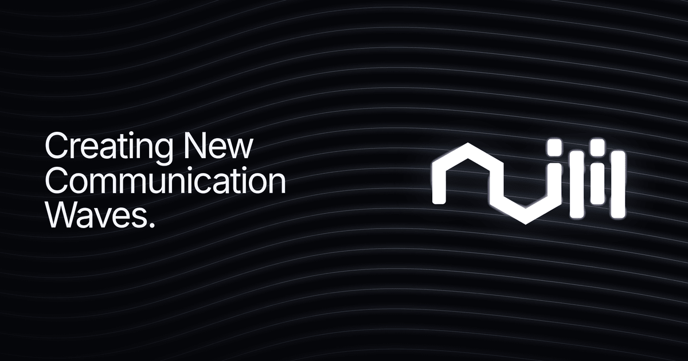

# Adaptive AIX

**Creating New Communication Waves.**  
From Idea to AI-Powered Business.

Adaptive AIX turns validated market problems into operational AI-powered businesses, using the same system for its own products and for selected clients.

**Validate. Build. Apply. Scale.**

## How it works

Most companies treat AI as a feature or a project. Adaptive AIX treats it as infrastructure. One system, two engines, and a white-label layer:

- **Internal engine** — we build our own AI-powered businesses, designed for reuse.
- **Client engine** — we apply the same system to selected companies and founders.
- **White-label layer** — proven internal products offered as ready capabilities. White-label is not automatic: a product is offered only after it meets the readiness standard.

No stage is skipped. Evidence is required before progress.

## Explore

- [Operating System](https://adaptiveaix.com/operating-system) — how Adaptive AIX works
- [Portfolio](https://adaptiveaix.com/portfolio) — current products and selected engagements, each with one stated stage
- [For Partners](https://adaptiveaix.com/for-partners) — how companies, investors, and programs work with Adaptive AIX
- [Start a conversation](https://adaptiveaix.com/contact)

## Connect

[Website](https://adaptiveaix.com) · [LinkedIn](https://www.linkedin.com/company/adaptiveaix) · [X](https://x.com/AdaptiveAIX) · [Telegram](https://t.me/AdaptiveAIX) · [Crunchbase](https://www.crunchbase.com/organization/adaptive-aix) · [Linktree](https://linktr.ee/AdaptiveAIX) · contact@adaptiveaix.com

© 2026 Adaptive AIX. All rights reserved. See [LICENSE](./LICENSE).
